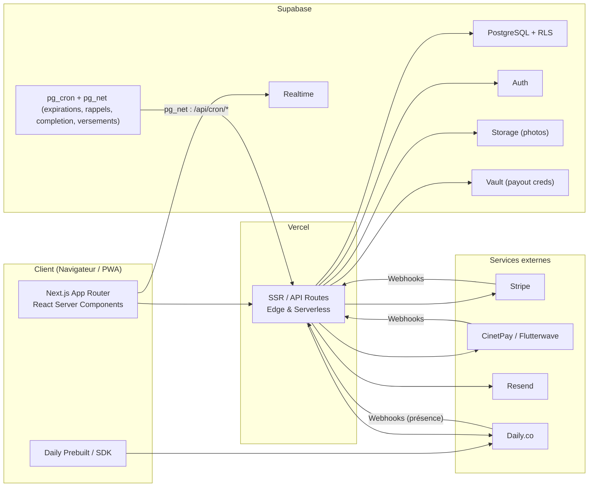
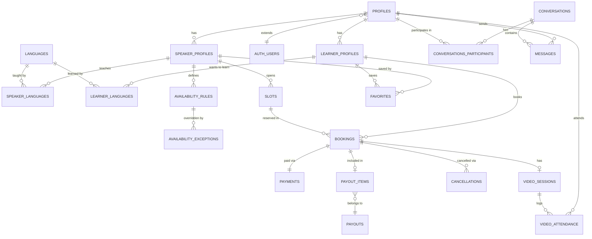
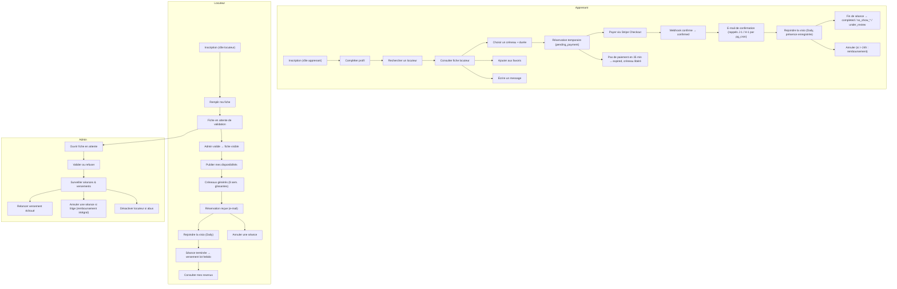

# Noosre – Architecture technique

> Document d'architecture à valider avant tout développement.
> Généré à partir de [docs/cahier-des-charges.md](file:///Users/jean-claudeguina/Projets-Guinam/noosre/docs/cahier-des-charges.md).
> Corrigé d'après [docs/retours-architecture.md](file:///Users/jean-claudeguina/Projets-Guinam/noosre/docs/retours-architecture.md).

---

## Table des matières

1. [Architecture technique & stack](#1-architecture-technique--stack)
2. [Structure des dossiers](#2-structure-des-dossiers)
3. [Schéma de la base de données Supabase](#3-schéma-de-la-base-de-données-supabase)
4. [Liste des écrans & parcours utilisateur](#4-liste-des-écrans--parcours-utilisateur)
5. [Ordre de développement recommandé](#5-ordre-de-développement-recommandé)
6. [Décisions & zones floues résolues](#6-décisions--zones-floues-résolues)

---

## 1. Architecture technique & stack

### Stack retenue

| Couche | Choix | Justification |
|---|---|---|
| Framework | **Next.js (dernière version stable, App Router)** | SSR/SSG, API Routes, RSC, optimisations images. `proxy.ts` remplace `middleware.ts` dans les versions récentes. |
| Langage | **TypeScript strict** | Exigence du cahier des charges |
| Styles | **Tailwind CSS 4** | Mobile-first, classes utilitaires, responsive. Configuration dans le CSS (pas de `tailwind.config.ts`). |
| Composants UI | **shadcn/ui** | Composants accessibles, personnalisables |
| BDD & Auth | **Supabase** (PostgreSQL + Auth + Realtime + Storage + Vault + pg_cron) | Auth, RLS, temps réel messagerie, chiffrement coordonnées, tâches planifiées |
| Visio | **Daily** | Interface prête à l'emploi, mode audio seul, qualité adaptative, offre gratuite suffisante pour le lancement. Plus rapide à intégrer que LiveKit pour des cours humains sans agent IA. |
| Paiements entrants | **Stripe** (Checkout + Webhooks) | Standard EU/NA, robuste |
| Versements locuteurs | **CinetPay** (Afrique francophone) / **Flutterwave** (Afrique anglophone & Est) | Mobile money + virements bancaires |
| E-mails transactionnels | **Resend** | API simple, templates React. Les rappels J-1 / H-1 sont envoyés par une tâche `pg_cron` toutes les 5 min (pas d'envoi différé). |
| Hébergement | **Vercel** | Optimisé Next.js, Edge Functions, CDN mondial |
| PWA | **@serwist/next** | Manifest, service worker, page hors-ligne. Remplace `next-pwa` (non maintenu). |
| i18n | **next-intl** | Routage i18n App Router, français/anglais |
| Gestion dates/TZ | **date-fns** + **date-fns-tz** | Léger, manipulation IANA, pas de dépendance lourde |
| Validation | **Zod** | Schémas partagés client/serveur |
| Types BDD | **supabase gen types** | Types auto-générés depuis le schéma PostgreSQL |

### Diagramme d'architecture



---

## 2. Structure des dossiers

```
noosre/
├── public/
│   ├── icons/                   # Icônes PWA
│   ├── images/                  # Assets statiques
│   └── manifest.json            # Manifeste PWA
│
├── src/
│   ├── app/
│   │   ├── [locale]/            # Routage i18n (fr, en)
│   │   │   ├── (public)/        # Pages publiques (layout sans auth)
│   │   │   │   ├── page.tsx                  # Accueil
│   │   │   │   ├── langues/
│   │   │   │   │   └── [slug]/page.tsx       # Fiche langue
│   │   │   │   ├── inscription/page.tsx      # Inscription
│   │   │   │   ├── connexion/page.tsx        # Connexion
│   │   │   │   ├── mot-de-passe-oublie/page.tsx
│   │   │   │   ├── mentions-legales/page.tsx
│   │   │   │   ├── confidentialite/page.tsx
│   │   │   │   └── conditions/page.tsx
│   │   │   │
│   │   │   ├── apprenant/       # Espace apprenant (préfixe réel, layout auth + rôle)
│   │   │   │   ├── tableau-de-bord/page.tsx
│   │   │   │   ├── profil/page.tsx
│   │   │   │   ├── recherche/page.tsx        # Catalogue locuteurs
│   │   │   │   ├── locuteur/[id]/page.tsx    # Fiche locuteur
│   │   │   │   ├── favoris/page.tsx
│   │   │   │   ├── reservation/[slotId]/page.tsx
│   │   │   │   ├── paiement/
│   │   │   │   │   ├── page.tsx              # Redirection Stripe
│   │   │   │   │   └── confirmation/page.tsx
│   │   │   │   ├── seances/page.tsx          # Mes séances
│   │   │   │   ├── progression/page.tsx
│   │   │   │   └── messagerie/
│   │   │   │       ├── page.tsx              # Liste conversations
│   │   │   │       └── [conversationId]/page.tsx
│   │   │   │
│   │   │   ├── locuteur/        # Espace locuteur (préfixe réel, layout auth + rôle)
│   │   │   │   ├── tableau-de-bord/page.tsx
│   │   │   │   ├── fiche/page.tsx            # Ma fiche
│   │   │   │   ├── disponibilites/page.tsx
│   │   │   │   ├── seances/page.tsx
│   │   │   │   ├── revenus/page.tsx
│   │   │   │   ├── versement/page.tsx        # Moyen de versement
│   │   │   │   └── messagerie/
│   │   │   │       ├── page.tsx
│   │   │   │       └── [conversationId]/page.tsx
│   │   │   │
│   │   │   ├── compte/          # Pages partagées (auth requise)
│   │   │   │   └── page.tsx                  # Paramètres compte
│   │   │   │
│   │   │   ├── visio/           # Salle de visio (auth requise)
│   │   │   │   └── [sessionId]/page.tsx
│   │   │   │
│   │   │   └── admin/           # Espace administrateur (préfixe réel)
│   │   │       ├── tableau-de-bord/page.tsx
│   │   │       ├── locuteurs/page.tsx        # Validation fiches
│   │   │       ├── locuteurs/[id]/page.tsx
│   │   │       ├── seances/page.tsx
│   │   │       ├── versements/page.tsx
│   │   │       ├── annulations/page.tsx      # Suivi annulations
│   │   │       └── parametres/page.tsx       # Commission, etc.
│   │   │
│   │   └── api/
│   │       ├── webhooks/
│   │       │   ├── stripe/route.ts
│   │       │   ├── cinetpay/route.ts
│   │       │   ├── flutterwave/route.ts
│   │       │   └── daily/route.ts            # participant.joined / participant.left → video_attendance
│   │       ├── cron/                         # Appelées par pg_cron via pg_net (secret partagé en en-tête)
│   │       │   ├── generate-slots/route.ts   # Maintien de l'horizon de 8 semaines
│   │       │   ├── reminders/route.ts        # Rappels J-1 / H-1 arrivés à échéance
│   │       │   ├── complete-sessions/route.ts # Statut final + remboursement éventuel
│   │       │   └── payouts/route.ts          # Lot hebdomadaire de versements
│   │       ├── bookings/
│   │       │   ├── route.ts                  # Création réservation (service role, montants calculés côté serveur)
│   │       │   └── [id]/cancel/route.ts      # Annulation (apprenant, locuteur, admin) + remboursement
│   │       ├── availability/route.ts         # Règles + exceptions du locuteur, régénération des créneaux
│   │       ├── slots/route.ts                # Créneaux ponctuels (création / retrait d'un créneau available)
│   │       ├── account/delete/route.ts       # Anonymisation RGPD
│   │       └── daily/
│   │           └── room/route.ts             # Création salle + génération token Daily (avec vérifications)
│   │
│   ├── components/
│   │   ├── ui/                  # Composants shadcn/ui personnalisés
│   │   ├── layout/              # Header, Sidebar, BottomNav, Footer
│   │   ├── forms/               # Formulaires réutilisables
│   │   ├── sessions/            # Cartes séance, calendrier
│   │   ├── messaging/           # Bulle message, liste conversations
│   │   └── video/               # Composant salle visio (Daily Prebuilt)
│   │
│   ├── lib/
│   │   ├── supabase/
│   │   │   ├── client.ts        # Client navigateur
│   │   │   ├── server.ts        # Client serveur (cookies)
│   │   │   ├── admin.ts         # Client service_role (webhooks, bookings, conversations)
│   │   │   └── types.ts         # Types auto-générés
│   │   ├── stripe.ts
│   │   ├── cinetpay.ts
│   │   ├── flutterwave.ts
│   │   ├── resend.ts
│   │   ├── daily.ts
│   │   ├── slots.ts             # Algorithme de génération des créneaux
│   │   └── utils.ts
│   │
│   ├── hooks/                   # Hooks React personnalisés
│   │   ├── use-timezone.ts
│   │   ├── use-realtime.ts
│   │   └── use-session.ts
│   │
│   ├── schemas/                 # Schémas Zod (validation)
│   │
│   ├── i18n/
│   │   ├── fr.json
│   │   └── en.json
│   │
│   ├── styles/
│   │   └── globals.css          # Tailwind 4 directives + tokens Noosre (config CSS, pas de tailwind.config.ts)
│   │
│   └── proxy.ts                 # Auth + redirection rôle + i18n (remplace middleware.ts)
│
├── supabase/
│   ├── migrations/              # Migrations SQL (schéma, triggers, contraintes, pg_cron)
│   └── seed.sql                 # Données de test
│
├── docs/
│   ├── cahier-des-charges.md
│   ├── retours-architecture.md
│   └── architecture.md          # Ce fichier
│
├── next.config.ts
├── tsconfig.json
└── package.json
```

---

## 3. Schéma de la base de données Supabase

### Diagramme entité-relation



### Tables détaillées

#### `profiles`
Étend `auth.users` de Supabase.

| Colonne | Type | Contraintes | Description |
|---|---|---|---|
| `id` | `uuid` | PK, FK → auth.users.id | Identifiant unique |
| `role` | `enum('learner','speaker','admin')` | NOT NULL | Rôle principal |
| `first_name` | `text` | NOT NULL | Prénom |
| `last_name` | `text` | NOT NULL | Nom |
| `avatar_url` | `text` | | URL photo (Supabase Storage) |
| `timezone` | `text` | NOT NULL, défaut détecté | Fuseau IANA (ex. `Europe/Paris`) |
| `ui_language` | `enum('fr','en')` | NOT NULL, défaut `'fr'` | Langue d'interface |
| `country` | `text` | | Pays de résidence (code ISO) |
| `notify_email` | `boolean` | NOT NULL, défaut `true` | Préférence notifications |
| `is_deleted` | `boolean` | NOT NULL, défaut `false` | Profil anonymisé (suppression RGPD) |
| `deleted_at` | `timestamptz` | | Date d'anonymisation |
| `created_at` | `timestamptz` | NOT NULL, défaut `now()` | |
| `updated_at` | `timestamptz` | NOT NULL, défaut `now()` | |

> [!IMPORTANT]
> **Création du profil** : le client n'insère jamais dans `profiles`. Un trigger `handle_new_user` (`AFTER INSERT` sur `auth.users`, `SECURITY DEFINER`) crée la ligne à partir des métadonnées d'inscription ; le rôle n'y est accepté que s'il vaut `learner` ou `speaker` (toute autre valeur fait échouer l'inscription). Les admins sont créés manuellement en base.
>
> **Trigger `protect_profile_fields`** : un trigger `BEFORE UPDATE` sur `profiles` refuse toute modification de `role`, `is_deleted` et `deleted_at` sauf par un admin ou le service role. Les politiques RLS ne filtrent pas par colonne : sans ce trigger, un utilisateur pourrait passer son rôle à `admin`.

> [!IMPORTANT]
> **Suppression de compte (RGPD) = anonymisation**, jamais suppression physique. Voir la section [Suppression de compte (RGPD)](#suppression-de-compte-rgpd).

#### `languages`
Catalogue des langues africaines proposées. Contenu géré par l'admin, avec la liste des locuteurs ajoutée dynamiquement.

| Colonne | Type | Contraintes | Description |
|---|---|---|---|
| `id` | `uuid` | PK | |
| `slug` | `text` | UNIQUE, NOT NULL | URL-friendly (ex. `wolof`) |
| `name_fr` | `text` | NOT NULL | Nom en français |
| `name_en` | `text` | NOT NULL | Nom en anglais |
| `description_fr` | `text` | | Présentation longue FR |
| `description_en` | `text` | | Présentation longue EN |
| `region` | `text` | | Où elle est parlée |
| `speakers_count` | `text` | | Nombre de locuteurs (approximatif) |
| `alphabet` | `text` | | Alphabet utilisé |
| `has_tones` | `boolean` | défaut `false` | Langue tonale ? |
| `sample_words` | `jsonb` | | Mots et expressions de base |
| `image_url` | `text` | | Illustration |

#### `learner_profiles`

| Colonne | Type | Contraintes | Description |
|---|---|---|---|
| `id` | `uuid` | PK, FK → profiles.id | |
| `level` | `enum('beginner','intermediate','advanced')` | | Niveau actuel global |
| `goals` | `text[]` | | Objectifs (famille, racines, voyage…) |
| `heritage_link` | `boolean` | | Lien d'héritage familial |
| `communication_language` | `enum('fr','en')` | NOT NULL, défaut `'fr'` | Langue de communication préférée |

#### `learner_languages`
Association apprenant ↔ langues souhaitées.

| Colonne | Type | Contraintes | Description |
|---|---|---|---|
| `id` | `uuid` | PK | |
| `learner_id` | `uuid` | FK → learner_profiles.id, NOT NULL | |
| `language_id` | `uuid` | FK → languages.id, NOT NULL | |
| `level` | `enum('beginner','intermediate','advanced')` | NOT NULL | Niveau pour cette langue |
| | | UNIQUE(learner_id, language_id) | |

#### `speaker_profiles`

| Colonne | Type | Contraintes | Description |
|---|---|---|---|
| `id` | `uuid` | PK, FK → profiles.id | |
| `bio_fr` | `text` | | Présentation FR |
| `bio_en` | `text` | | Présentation EN |
| `accepted_levels` | `text[]` | NOT NULL | Niveaux acceptés |
| `hourly_rate` | `integer` | NOT NULL, CHECK 500 ≤ val ≤ 3500 | Tarif horaire en centimes EUR (min 5 €, max 35 €) |
| `session_durations` | `smallint[]` | NOT NULL, sous-ensemble de {30, 45, 60} | Durées de séance proposées (minutes) |
| `status` | `enum('draft','pending','approved','rejected','suspended')` | NOT NULL, défaut `'draft'` | État de validation |
| `rejection_reason` | `text` | | Motif de refus |
| `cancellation_count` | `integer` | NOT NULL, défaut `0` | Compteur d'annulations |
| `payout_method` | `enum('bank','orange_money','wave','mpesa','mtn_momo')` | | Moyen de versement |
| `payout_provider_id` | `text` | | Identifiant du bénéficiaire chez le prestataire (CinetPay / Flutterwave). Pas de coordonnées en clair. |
| `payout_provider` | `enum('cinetpay','flutterwave')` | | Prestataire versement |
| `approved_at` | `timestamptz` | | Date de validation |

> [!IMPORTANT]
> **Trigger `protect_speaker_admin_fields`** (`BEFORE INSERT OR UPDATE` sur `speaker_profiles`), appliqué à tout appelant qui n'est ni admin ni service role :
> - **À l'INSERT** : force `status` = `'draft'`, `rejection_reason` = NULL, `cancellation_count` = 0, `approved_at` = NULL, et les champs de versement (`payout_method`, `payout_provider`, `payout_provider_id`) à NULL. Un locuteur ne peut donc pas créer directement une fiche `approved`.
> - **À l'UPDATE** : refuse toute modification de `rejection_reason`, `cancellation_count`, `approved_at` et des champs de versement. Pour `status`, seules les transitions de soumission sont permises au propriétaire : `draft` → `pending` et `rejected` → `pending`. Une fiche `approved` modifiée par son propriétaire (bio, tarif, langues…) reste `approved`, sans nouvelle validation.
>
> Les champs de versement ne sont écrits que par la route serveur de la page « Moyen de versement », après création du bénéficiaire chez le prestataire. Un locuteur ne peut pas y mettre l'identifiant de bénéficiaire de quelqu'un d'autre pour détourner un versement.

> [!IMPORTANT]
> **Coordonnées de versement** : on ne stocke PAS de numéro de compte ou de mobile money en clair. On stocke l'identifiant du bénéficiaire créé chez le prestataire de paiement (`payout_provider_id`). Si un stockage temporaire est nécessaire pour la création du bénéficiaire, utiliser **Supabase Vault**.

#### `speaker_languages`
Association locuteur ↔ langues enseignées (many-to-many).

| Colonne | Type | Contraintes | Description |
|---|---|---|---|
| `id` | `uuid` | PK | |
| `speaker_id` | `uuid` | FK → speaker_profiles.id, NOT NULL | |
| `language_id` | `uuid` | FK → languages.id, NOT NULL | |
| | | UNIQUE(speaker_id, language_id) | |

#### `availability_rules`
Créneaux récurrents (répétition hebdomadaire).

| Colonne | Type | Contraintes | Description |
|---|---|---|---|
| `id` | `uuid` | PK | |
| `speaker_id` | `uuid` | FK → speaker_profiles.id, NOT NULL | |
| `day_of_week` | `smallint` | NOT NULL, 0-6 (lundi=0) | Jour de la semaine |
| `start_time` | `time` | NOT NULL | Heure de début (heure locale locuteur) |
| `end_time` | `time` | NOT NULL | Heure de fin |
| `timezone` | `text` | NOT NULL | Fuseau IANA du locuteur au moment de la création |
| `is_active` | `boolean` | NOT NULL, défaut `true` | Règle active |
| `created_at` | `timestamptz` | NOT NULL | |

#### `availability_exceptions`
Exceptions aux règles (retrait d'une occurrence).

| Colonne | Type | Contraintes | Description |
|---|---|---|---|
| `id` | `uuid` | PK | |
| `rule_id` | `uuid` | FK → availability_rules.id, NOT NULL | |
| `exception_date` | `date` | NOT NULL | Date de l'occurrence supprimée |
| `reason` | `text` | | Motif (optionnel) |

#### `slots`
Créneaux concrets générés (disponibles à la réservation).

| Colonne | Type | Contraintes | Description |
|---|---|---|---|
| `id` | `uuid` | PK | |
| `speaker_id` | `uuid` | FK → speaker_profiles.id, NOT NULL | |
| `rule_id` | `uuid` | FK → availability_rules.id | Règle source (NULL si ponctuel) |
| `start_at` | `timestamptz` | NOT NULL | Début en UTC |
| `end_at` | `timestamptz` | NOT NULL | Fin en UTC |
| `duration_minutes` | `smallint` | NOT NULL, CHECK IN (30, 45, 60) | Durée de la séance |
| `status` | `enum('available','held','booked','cancelled')` | NOT NULL, défaut `'available'` | `held` = réservation temporaire en cours de paiement |
| `held_until` | `timestamptz` | | Fin du blocage temporaire (création + **35 min**) |
| `created_at` | `timestamptz` | NOT NULL | |

> [!IMPORTANT]
> **Contrainte d'exclusion anti-chevauchement** : une contrainte PostgreSQL `EXCLUDE USING gist` (extension `btree_gist`) empêche un locuteur d'avoir deux créneaux **`held` ou `booked`** qui se chevauchent :
> ```sql
> ALTER TABLE slots ADD CONSTRAINT no_overlap
>   EXCLUDE USING gist (
>     speaker_id WITH =,
>     tstzrange(start_at, end_at) WITH &&
>   ) WHERE (status IN ('held', 'booked'));
> ```
> Les créneaux `available` peuvent se chevaucher entre eux (ex. un 30 min et un 60 min qui commencent tous deux à 18h00) : ce sont des **offres candidates**. Le passage d'un créneau en `held` est l'opération qui « verrouille » la plage : si un créneau `held`/`booked` chevauchant existe déjà, la contrainte fait échouer l'UPDATE et la réservation est refusée (pas de condition de course possible).

> [!NOTE]
> **Masquage des créneaux chevauchants** : la recherche et la fiche locuteur ne proposent un créneau `available` que s'il ne chevauche **aucun** créneau `held` (avec `held_until` non dépassé) ou `booked` du même locuteur. Ce filtre est appliqué dans une vue `bookable_slots` (lecture publique), pas en modifiant les lignes : quand une réservation expire ou est annulée, le créneau repasse en `available` (ou `cancelled`) et les créneaux chevauchants **réapparaissent automatiquement**.

> [!NOTE]
> **Algorithme de génération des créneaux** (implémenté dans `src/lib/slots.ts`) :
> 1. **Horizon glissant** : les créneaux sont générés sur **8 semaines** à l'avance. Un job `pg_cron` quotidien régénère les créneaux manquants pour maintenir l'horizon.
> 2. **Découpage** : chaque plage horaire (ex. 18h–20h) est découpée en créneaux selon les `session_durations` du locuteur. Si le locuteur propose 30 et 60 min, la plage 18h–20h génère des créneaux de 30 min (18h00, 18h30, 19h00, 19h30) **et/ou** de 60 min (18h00, 19h00). Chaque couple (heure de début, durée) est une ligne `slots` distincte. L'apprenant choisit une heure de début puis une durée parmi celles encore proposées (vue `bookable_slots`), ce qui désigne un créneau précis.
> 3. **Conversion UTC** : chaque occurrence est convertie individuellement depuis le fuseau IANA du locuteur vers UTC, pour gérer correctement les changements d'heure (heure d'été/hiver en Europe/NA, Ramadan au Maroc, etc.).
> 4. **Modification de règle** : quand une règle change, les créneaux futurs `available` issus de cette règle sont supprimés et régénérés. Les créneaux `held` et `booked` restent intacts.
> 5. **Exceptions** : une exception supprime le créneau généré pour la date donnée (s'il n'est pas réservé).

#### `bookings`
Réservations de séances.

| Colonne | Type | Contraintes | Description |
|---|---|---|---|
| `id` | `uuid` | PK | |
| `slot_id` | `uuid` | FK → slots.id, NOT NULL | Index unique partiel : une seule booking active par slot (`WHERE status NOT IN ('expired','cancelled_learner','cancelled_speaker','cancelled_admin')`), pour pouvoir réserver de nouveau un créneau libéré |
| `learner_id` | `uuid` | FK → learner_profiles.id, NOT NULL | |
| `speaker_id` | `uuid` | FK → speaker_profiles.id, NOT NULL | |
| `status` | `enum('pending_payment','expired','confirmed','completed','no_show_learner','no_show_speaker','no_show_both','under_review','cancelled_learner','cancelled_speaker','cancelled_admin')` | NOT NULL, défaut `'pending_payment'` | `pending_payment` = en attente du webhook Stripe ; `expired` = blocage expiré sans paiement (conservée pour l'historique) ; voir « Présence en visio » pour les statuts de fin |
| `duration_minutes` | `smallint` | NOT NULL, CHECK IN (30, 45, 60) | Durée de la séance |
| `amount` | `integer` | NOT NULL | Montant payé (centimes EUR), calculé côté serveur : tarif_horaire × durée / 60 |
| `commission_rate` | `numeric(5,4)` | NOT NULL | Taux de commission appliqué |
| `commission_amount` | `integer` | NOT NULL | Commission Noosre (centimes) |
| `speaker_amount` | `integer` | NOT NULL | Part locuteur (centimes) |
| `expires_at` | `timestamptz` | | Fin du blocage `pending_payment` (création + 35 min) |
| `stripe_checkout_session_id` | `text` | UNIQUE | Session Checkout (expiration 30 min) |
| `confirmed_at` | `timestamptz` | | Date de confirmation du paiement |
| `reminder_24h_sent_at` | `timestamptz` | | Rappel J-1 envoyé (NULL = pas encore) |
| `reminder_1h_sent_at` | `timestamptz` | | Rappel H-1 envoyé (NULL = pas encore) |
| `cancelled_at` | `timestamptz` | | |
| `completed_at` | `timestamptz` | | |
| `created_at` | `timestamptz` | NOT NULL | |

> [!IMPORTANT]
> **Réservation créée côté serveur uniquement** : la route `POST /api/bookings` (service role) crée la booking avec les montants calculés à partir du tarif en base. L'apprenant n'envoie que le `slot_id` et la `duration_minutes`. Les champs `amount`, `commission_amount`, `speaker_amount` ne sont **jamais** transmis par le navigateur. Cela empêche la manipulation des montants.

> [!NOTE]
> **Flux de réservation anti-double réservation** :
> 1. L'apprenant clique « Réserver » → `POST /api/bookings`, dans une transaction : le slot passe en `held` (la contrainte d'exclusion refuse s'il y a chevauchement), `held_until` = now() + **35 min** ; la booking est créée en `pending_payment` avec `expires_at` = now() + 35 min.
> 2. Une session Stripe Checkout est créée avec une expiration de **30 min** (minimum autorisé par Stripe). La marge de 5 min garantit que la session est fermée avant la libération du créneau.
> 3. **Cas nominal** : webhook `checkout.session.completed` sur une booking `pending_payment` → booking `confirmed` (`confirmed_at` renseigné), slot `booked`, ligne `payments` créée.
> 4. **Abandon / expiration** : le webhook `checkout.session.expired` ou le job `pg_cron` `expire_pending_bookings` (toutes les 5 min, sur `expires_at` dépassé) passe la booking en **`expired`** (jamais supprimée) et le slot repasse en `available` → les créneaux chevauchants réapparaissent.
> 5. **Paiement tardif** (webhook `checkout.session.completed` reçu alors que la booking est déjà `expired`) : le serveur tente de repasser le slot en `booked`.
>    - Si le créneau est toujours libre (pas de chevauchement `held`/`booked`) → booking `confirmed`, cas nominal.
>    - Si le créneau a été repris → **remboursement intégral automatique** (Stripe Refund), `payments.status` = `refunded`, booking reste `expired`, e-mail d'excuse à l'apprenant.

> [!NOTE]
> **Statut final de la séance** : voir [Présence en visio](#présence-en-visio-et-statut-final-des-séances). Les versements hebdomadaires ne prennent en compte que les bookings `completed` et `no_show_learner`.

#### `payments`
Paiements Stripe entrants (apprenants).

| Colonne | Type | Contraintes | Description |
|---|---|---|---|
| `id` | `uuid` | PK | |
| `booking_id` | `uuid` | FK → bookings.id, UNIQUE, NOT NULL | |
| `stripe_payment_intent_id` | `text` | UNIQUE, NOT NULL | |
| `stripe_checkout_session_id` | `text` | UNIQUE | |
| `amount` | `integer` | NOT NULL | Montant en centimes |
| `currency` | `text` | NOT NULL, défaut `'eur'` | Toujours EUR |
| `status` | `enum('pending','succeeded','refunded','partially_refunded','failed')` | NOT NULL | |
| `refund_amount` | `integer` | | Montant remboursé |
| `refund_reason` | `text` | | |
| `stripe_fee` | `integer` | | Frais Stripe |
| `created_at` | `timestamptz` | NOT NULL | |
| `updated_at` | `timestamptz` | NOT NULL | |

#### `payouts`
Versements vers les locuteurs (lot hebdomadaire).

| Colonne | Type | Contraintes | Description |
|---|---|---|---|
| `id` | `uuid` | PK | |
| `speaker_id` | `uuid` | FK → speaker_profiles.id, NOT NULL | |
| `amount` | `integer` | NOT NULL | Montant en centimes EUR |
| `currency` | `text` | NOT NULL, défaut `'eur'` | Toujours EUR |
| `payout_currency` | `text` | | Devise locale du versement (ex. `XOF`, `KES`) |
| `local_amount` | `integer` | | Montant converti en devise locale (centimes) |
| `exchange_rate` | `numeric(12,6)` | | Taux de change EUR → devise locale |
| `provider` | `enum('cinetpay','flutterwave')` | NOT NULL | |
| `provider_reference` | `text` | | Réf. transaction prestataire |
| `status` | `enum('pending','processing','completed','failed')` | NOT NULL, défaut `'pending'` | |
| `fee_deducted` | `integer` | défaut `0` | Frais déduits (annulation tardive) |
| `batch_id` | `text` | NOT NULL | Identifiant lot hebdomadaire |
| `period_start` | `date` | NOT NULL | Début de la période couverte |
| `period_end` | `date` | NOT NULL | Fin de la période couverte |
| `attempted_at` | `timestamptz` | | |
| `completed_at` | `timestamptz` | | |
| `created_at` | `timestamptz` | NOT NULL | |

#### `payout_items`
Lien entre un versement et les séances qu'il couvre. Garantit qu'une séance n'est jamais versée deux fois.

| Colonne | Type | Contraintes | Description |
|---|---|---|---|
| `id` | `uuid` | PK | |
| `payout_id` | `uuid` | FK → payouts.id, NOT NULL | |
| `booking_id` | `uuid` | FK → bookings.id, UNIQUE, NOT NULL | UNIQUE empêche le double versement |
| `speaker_amount` | `integer` | NOT NULL | Part locuteur pour cette séance |

#### `cancellations`
Historique détaillé des annulations.

| Colonne | Type | Contraintes | Description |
|---|---|---|---|
| `id` | `uuid` | PK | |
| `booking_id` | `uuid` | FK → bookings.id, NOT NULL | |
| `cancelled_by` | `uuid` | FK → profiles.id, NOT NULL | Qui annule |
| `role` | `enum('learner','speaker','admin')` | NOT NULL | |
| `reason` | `text` | | |
| `is_late` | `boolean` | NOT NULL | Moins de 24 h avant la séance |
| `refund_eligible` | `boolean` | NOT NULL | Remboursement applicable |
| `created_at` | `timestamptz` | NOT NULL | |

#### `favorites`

| Colonne | Type | Contraintes | Description |
|---|---|---|---|
| `id` | `uuid` | PK | |
| `learner_id` | `uuid` | FK → learner_profiles.id, NOT NULL | |
| `speaker_id` | `uuid` | FK → speaker_profiles.id, NOT NULL | |
| `created_at` | `timestamptz` | NOT NULL | |
| | | UNIQUE(learner_id, speaker_id) | |

#### `conversations`

| Colonne | Type | Contraintes | Description |
|---|---|---|---|
| `id` | `uuid` | PK | |
| `created_at` | `timestamptz` | NOT NULL | |
| `updated_at` | `timestamptz` | NOT NULL | Dernier message |

> [!IMPORTANT]
> **Création de conversation côté serveur uniquement** : une conversation est créée via service role (route API ou function Supabase), entre un apprenant et un locuteur dont la fiche est `approved`. Pas d'INSERT direct par le client.

#### `conversations_participants`

| Colonne | Type | Contraintes | Description |
|---|---|---|---|
| `id` | `uuid` | PK | |
| `conversation_id` | `uuid` | FK → conversations.id, NOT NULL | |
| `profile_id` | `uuid` | FK → profiles.id, NOT NULL | |
| `last_read_at` | `timestamptz` | | Pour indicateur non lu |
| | | UNIQUE(conversation_id, profile_id) | |

#### `messages`

| Colonne | Type | Contraintes | Description |
|---|---|---|---|
| `id` | `uuid` | PK | |
| `conversation_id` | `uuid` | FK → conversations.id, NOT NULL | |
| `sender_id` | `uuid` | FK → profiles.id, NOT NULL | |
| `content` | `text` | NOT NULL | |
| `created_at` | `timestamptz` | NOT NULL | |

#### `video_sessions`

| Colonne | Type | Contraintes | Description |
|---|---|---|---|
| `id` | `uuid` | PK | |
| `booking_id` | `uuid` | FK → bookings.id, UNIQUE, NOT NULL | |
| `room_name` | `text` | UNIQUE, NOT NULL | Identifiant salle Daily |
| `started_at` | `timestamptz` | | |
| `ended_at` | `timestamptz` | | |
| `duration_minutes` | `integer` | | Durée effective |

#### `video_attendance`
Journal de présence alimenté par les webhooks Daily (`participant.joined`, `participant.left`) reçus sur `/api/webhooks/daily` (signature vérifiée). Une ligne par connexion : un participant qui se reconnecte a plusieurs lignes.

| Colonne | Type | Contraintes | Description |
|---|---|---|---|
| `id` | `uuid` | PK | |
| `video_session_id` | `uuid` | FK → video_sessions.id, NOT NULL | |
| `profile_id` | `uuid` | FK → profiles.id, NOT NULL | Identifié via le `user_id` inscrit dans le jeton Daily |
| `role` | `enum('learner','speaker')` | NOT NULL | |
| `daily_participant_id` | `text` | UNIQUE, NOT NULL | Identifiant de connexion Daily (idempotence des webhooks) |
| `joined_at` | `timestamptz` | NOT NULL | Arrivée |
| `left_at` | `timestamptz` | | Départ (NULL tant que connecté ; clôturé à `end_at` si aucun événement de départ) |

#### `admin_settings`

| Colonne | Type | Contraintes | Description |
|---|---|---|---|
| `id` | `uuid` | PK | |
| `key` | `text` | UNIQUE, NOT NULL | Ex. `commission_rate` |
| `value` | `jsonb` | NOT NULL | |
| `updated_at` | `timestamptz` | NOT NULL | |
| `updated_by` | `uuid` | FK → profiles.id | |

Clés prévues : `commission_rate`, `attendance_min_minutes` (défaut 5), `completion_min_overlap_ratio` (défaut 0,5).

### Présence en visio et statut final des séances

Le job `complete_sessions` (toutes les 15 min) traite les bookings `confirmed` dont `end_at` + 15 min est dépassé, à partir de `video_attendance` sur la fenêtre [`start_at` − 15 min ; `end_at`] :

- un participant est **présent** si son temps de connexion cumulé atteint `attendance_min_minutes` (5 min) ;
- le **temps commun** est la durée pendant laquelle les deux sont connectés simultanément.

| Cas | Statut | Apprenant | Locuteur |
|---|---|---|---|
| Les deux présents, temps commun ≥ 50 % de la durée | `completed` | Pas de remboursement | Part locuteur versée |
| Locuteur présent, apprenant absent | `no_show_learner` | Pas de remboursement (assimilé à une annulation tardive) | Part locuteur versée |
| Apprenant présent, locuteur absent | `no_show_speaker` | **Remboursement intégral automatique** | Rien versé ; `cancellation_count` + 1 ; traité comme une annulation tardive par le locuteur (frais déduits du prochain versement, cf. `payouts.fee_deducted`) ; e-mail à l'admin |
| Aucun des deux présent | `no_show_both` | **Remboursement intégral automatique** | Rien versé ; `cancellation_count` + 1 ; signalé à l'admin |
| Les deux présents mais temps commun < 50 % (souci technique, retard important) | `under_review` | En attente de décision | Exclu des versements jusqu'à décision |

> [!NOTE]
> Pour `under_review`, l'admin tranche depuis l'écran Séances : `completed` (versement), remboursement intégral (statut `cancelled_admin`), ou remboursement partiel. L'admin peut aussi corriger un statut automatique en cas de contestation, tant que la séance n'est pas incluse dans un versement.

### Triggers de sécurité

| Trigger | Table | Événement | Description |
|---|---|---|---|
| `handle_new_user` | `auth.users` | AFTER INSERT | Crée le profil ; rôle limité à `learner` / `speaker` |
| `protect_profile_fields` | `profiles` | BEFORE UPDATE | Refuse la modification de `role`, `is_deleted`, `deleted_at` sauf par admin ou service role |
| `protect_speaker_admin_fields` | `speaker_profiles` | BEFORE INSERT OR UPDATE | INSERT : valeurs initiales imposées. UPDATE : champs d'administration et de versement verrouillés ; `status` limité à `draft`/`rejected` → `pending` (sauf admin ou service role) |
| `update_updated_at` | `profiles`, `conversations` | BEFORE UPDATE | Met à jour `updated_at` automatiquement |

### Jobs pg_cron

| Job | Fréquence | Description |
|---|---|---|
| `generate_slots` | Quotidien, 03:00 UTC | Appelle `/api/cron/generate-slots` : génère les créneaux manquants pour maintenir l'horizon de 8 semaines (algorithme de `src/lib/slots.ts`) |
| `expire_pending_bookings` | Toutes les 5 min | Bookings `pending_payment` dont `expires_at` est passé → `expired`, slot → `available` (SQL) |
| `send_reminders` | Toutes les 5 min | Appelle `/api/cron/reminders` : envoie via Resend les rappels J-1 et H-1 arrivés à échéance |
| `complete_sessions` | Toutes les 15 min | Appelle `/api/cron/complete-sessions` : statut final d'après `video_attendance`, remboursements Stripe si besoin |
| `weekly_payouts` | Hebdo, lundi 06:00 UTC | Appelle `/api/cron/payouts` : lots de versements pour les séances `completed` / `no_show_learner` absentes de `payout_items` |

> [!NOTE]
> Les jobs qui appellent une API externe (Resend, Stripe, CinetPay, Flutterwave) passent par `pg_net` vers une route Next.js `/api/cron/*` protégée par un secret partagé ; les jobs purement SQL s'exécutent dans la base.

> [!NOTE]
> **Rappels J-1 / H-1** : à chaque passage, `/api/cron/reminders` sélectionne les bookings `confirmed` dont `start_at` − 24 h (resp. − 1 h) est atteint et `reminder_24h_sent_at` (resp. `reminder_1h_sent_at`) est NULL, **réserve** la ligne en renseignant la date d'envoi (UPDATE … RETURNING, pour éviter un double envoi si deux exécutions se chevauchent), puis envoie l'e-mail à l'apprenant et au locuteur dans leur fuseau. Une séance annulée sort naturellement de la sélection : aucun rappel à annuler. Si la réservation est confirmée moins de 24 h (resp. 1 h) avant la séance, le rappel concerné n'est pas envoyé (l'e-mail de confirmation en tient lieu). Précision : ± 5 min.

### Règles RLS (Row Level Security)

Toutes les tables ont RLS activé. Voici les politiques par rôle :

#### Profils & sous-profils

| Table | Opération | Politique |
|---|---|---|
| `profiles` | SELECT | Propriétaire + admins uniquement (les autres passent par la vue `public_profiles`) |
| `profiles` | INSERT | Aucun client : création par le trigger `handle_new_user` |
| `profiles` | UPDATE | Uniquement son propre profil (le trigger `protect_profile_fields` bloque `role`, `is_deleted`, `deleted_at`) |
| `learner_profiles` | SELECT | Propriétaire + admins |
| `learner_profiles` | INSERT/UPDATE | Propriétaire uniquement |
| `speaker_profiles` | SELECT | Propriétaire + admins uniquement (le public passe par la vue `public_speakers`) |
| `speaker_profiles` | INSERT | Propriétaire (si rôle = speaker) |
| `speaker_profiles` | UPDATE | Propriétaire (le trigger `protect_speaker_admin_fields` bloque les champs sensibles) ; admins (tous champs) |

#### Vues publiques (exposition limitée des colonnes)

Les politiques RLS filtrent des **lignes**, pas des colonnes : ouvrir `SELECT` sur `profiles` ou `speaker_profiles` exposerait aussi le fuseau, le pays, les préférences, `payout_provider_id`, `cancellation_count` ou `rejection_reason`. Les autres utilisateurs ne lisent donc jamais ces tables directement, mais deux vues qui ne contiennent que les colonnes publiques :

| Vue | Colonnes | Lignes visibles | Accès |
|---|---|---|---|
| `public_profiles` | `id`, `role`, `first_name`, initiale du nom (`left(last_name, 1)`), `avatar_url`, `is_deleted` | Son propre profil ; profils des locuteurs `approved` ; profils avec lesquels l'utilisateur partage une réservation ou une conversation | `anon` (locuteurs `approved` seulement), `authenticated` |
| `public_speakers` | `id`, `bio_fr`, `bio_en`, `accepted_levels`, `hourly_rate`, `session_durations`, langues enseignées + colonnes de `public_profiles` | Fiches `status = 'approved'` dont le profil n'est pas anonymisé | `anon`, `authenticated` |

> [!NOTE]
> Ces vues s'exécutent avec les droits de leur propriétaire (sans `security_invoker`) pour passer outre la RLS des tables sous-jacentes. Le filtrage des lignes est donc écrit **dans la vue** (avec `auth.uid()`). Elles ne sont accessibles qu'en lecture, et ce sont les seuls objets exposés au public pour ces données. Pour un profil anonymisé, `public_profiles` renvoie « Utilisateur supprimé » sans photo.

#### Langues & associations

| Table | Opération | Politique |
|---|---|---|
| `languages` | SELECT | Public (aucune auth requise) |
| `languages` | INSERT/UPDATE/DELETE | Admins uniquement |
| `speaker_languages` | SELECT | Public (pour la recherche) |
| `speaker_languages` | INSERT/DELETE | Propriétaire (speaker) |

#### Disponibilités & créneaux

| Table | Opération | Politique |
|---|---|---|
| `availability_rules` | SELECT | Propriétaire (speaker) + admins |
| `availability_rules` | INSERT/UPDATE/DELETE | Service role (route `/api/availability`, qui valide puis régénère les créneaux) + admins |
| `availability_exceptions` | SELECT | Propriétaire (via rule) + admins |
| `availability_exceptions` | INSERT/UPDATE/DELETE | Service role (route `/api/availability`) + admins |
| `slots` | SELECT | Public via la vue `bookable_slots` (créneaux `available` sans chevauchement `held`/`booked`) ; propriétaire (speaker) voit tous les siens ; admins voient tout |
| `slots` | INSERT/UPDATE/DELETE | **Service role uniquement** + admins. Aucun accès en écriture pour le locuteur |

> [!IMPORTANT]
> **Le locuteur n'écrit jamais directement dans `slots`.** Sinon il pourrait repasser un créneau `booked` en `available` (ou le supprimer) et casser une réservation payée. Tous les changements passent par le serveur :
> - **Génération / régénération** : `/api/availability` (après modification d'une règle ou d'une exception) et le job `generate_slots`.
> - **Créneau ponctuel** : `/api/slots` vérifie que la fiche est `approved`, que le créneau est dans le futur et que sa durée fait partie des `session_durations`. Le statut est forcé à `available`. Le retrait n'est possible que pour un créneau `available`.
> - **`held` / `booked` / `cancelled`** : uniquement par les flux de réservation, d'expiration et d'annulation (`/api/bookings`, webhooks Stripe, `/api/bookings/[id]/cancel`, jobs `pg_cron`). Un locuteur qui veut libérer un créneau réservé doit **annuler la séance**, avec les règles d'annulation prévues (remboursement de l'apprenant, `cancellation_count`, frais).

#### Réservations & paiements

| Table | Opération | Politique |
|---|---|---|
| `bookings` | SELECT | Apprenant concerné + locuteur concerné + admins |
| `bookings` | INSERT | **Service role uniquement** (route API `/api/bookings`, montants calculés côté serveur) |
| `bookings` | UPDATE | Service role (webhooks, crons) + admins |
| `payments` | SELECT | Apprenant concerné + admins |
| `payments` | INSERT/UPDATE | Service role uniquement (webhooks Stripe) |
| `payouts` | SELECT | Locuteur concerné + admins |
| `payouts` | INSERT/UPDATE | Service role uniquement (cron hebdomadaire) |
| `payout_items` | SELECT | Locuteur concerné (via payout) + admins |
| `payout_items` | INSERT | Service role uniquement |
| `cancellations` | SELECT | Participants + admins |
| `cancellations` | INSERT | Service role + admins |

#### Favoris

| Table | Opération | Politique |
|---|---|---|
| `favorites` | ALL | Propriétaire (learner) uniquement |

#### Messagerie

| Table | Opération | Politique |
|---|---|---|
| `conversations` | SELECT | Participants + admins (en cas de litige) |
| `conversations` | INSERT | **Service role uniquement** (entre un apprenant et un locuteur `approved`) |
| `conversations_participants` | SELECT | Participants + admins |
| `conversations_participants` | INSERT | Service role uniquement |
| `messages` | SELECT | Participants à la conversation + admins |
| `messages` | INSERT | Participant à la conversation |

#### Visio & admin

| Table | Opération | Politique |
|---|---|---|
| `video_sessions` | SELECT | Participants à la booking + admins |
| `video_sessions` | INSERT/UPDATE | Service role |
| `video_attendance` | SELECT | Participants à la booking + admins |
| `video_attendance` | INSERT/UPDATE | Service role uniquement (webhooks Daily) |
| `admin_settings` | ALL | Admins uniquement |

### Suppression de compte (RGPD)

La demande vient de la page `/compte` et passe par `POST /api/account/delete` (service role, en une transaction). Les données financières doivent être conservées pendant la durée légale (10 ans en France pour les pièces comptables). Le compte est donc **anonymisé**, jamais supprimé physiquement.

**Conditions préalables** (sinon la demande est refusée avec un message explicatif) :
- aucune séance future `pending_payment` ou `confirmed` : l'utilisateur doit d'abord les annuler, avec les règles d'annulation habituelles ;
- pour un locuteur : aucune séance `completed` / `no_show_learner` en attente de versement, ni de versement `pending` / `processing`. Le compte peut être anonymisé après le prochain versement hebdomadaire.

**Traitement** :

| Donnée | Action |
|---|---|
| `profiles` | Ligne conservée : `first_name` = « Utilisateur », `last_name` = « supprimé », `avatar_url` = NULL, `country` = NULL, `notify_email` = false, `is_deleted` = true, `deleted_at` = now() |
| Photo (Storage) | Fichier supprimé |
| `auth.users` | Ligne conservée mais rendue inutilisable via l'API admin : e-mail remplacé par `deleted-<uuid>@noosre.invalid`, mot de passe aléatoire, sessions révoquées, compte banni |
| `learner_profiles` | `goals`, `heritage_link` = NULL ; `learner_languages` et `favorites` supprimés |
| `speaker_profiles` | `bio_fr`, `bio_en` = NULL, `status` = `suspended` (disparaît de `public_speakers`) ; bénéficiaire supprimé chez le prestataire puis `payout_provider_id` = NULL ; `speaker_languages`, `availability_rules`, `availability_exceptions` et créneaux futurs `available` supprimés |
| `bookings`, `payments`, `payouts`, `payout_items`, `cancellations`, `video_sessions`, `video_attendance` | **Conservés tels quels** (pièces comptables), rattachés au profil anonymisé |
| `messages`, `conversations` | Conservés pour l'autre participant ; l'auteur s'affiche « Utilisateur supprimé » (via `public_profiles`) |

**Clés étrangères** : toutes les FK qui pointent vers `profiles` ou ses sous-profils depuis les tables financières, de séance ou de messagerie sont en `ON DELETE RESTRICT`, ainsi que `profiles.id` → `auth.users.id`. Une suppression physique accidentelle échoue au lieu d'effacer l'historique en cascade. Seules les tables de préférences (`learner_languages`, `speaker_languages`, `favorites`, `availability_*`) sont en `ON DELETE CASCADE`.

### Sécurité de la salle de visio

> [!IMPORTANT]
> La route `POST /api/daily/room` (génération du token Daily et création de la salle) vérifie :
> 1. L'utilisateur est **l'apprenant ou le locuteur** de la réservation.
> 2. La réservation est au statut **`confirmed`**.
> 3. L'heure actuelle est dans une **fenêtre de 15 min avant le début** jusqu'à la **fin de la séance**.
> Toute requête hors de ces conditions est rejetée (403).

---

## 4. Liste des écrans & parcours utilisateur

### 4.1 Partie publique (7 écrans)

| # | Écran | Route | Description |
|---|---|---|---|
| P1 | Accueil | `/` | Hero, proposition de valeur, langues mises en avant, CTA inscription |
| P2 | Fiche langue | `/langues/[slug]` | Présentation langue + liste des locuteurs approuvés qui l'enseignent |
| P3 | Inscription | `/inscription` | Choix du rôle, formulaire, validation e-mail |
| P4 | Connexion | `/connexion` | E-mail + mot de passe |
| P5 | Mot de passe oublié | `/mot-de-passe-oublie` | Envoi lien de réinitialisation |
| P6 | Mentions légales | `/mentions-legales` | Contenu statique |
| P7 | Confidentialité / CGU | `/confidentialite`, `/conditions` | Contenu statique |

### 4.2 Espace apprenant (10 écrans)

| # | Écran | Route | Description |
|---|---|---|---|
| A1 | Tableau de bord | `/apprenant/tableau-de-bord` | Prochaines séances, progression rapide |
| A2 | Mon profil | `/apprenant/profil` | Édition photo, langues, niveau, objectifs |
| A3 | Recherche locuteurs | `/apprenant/recherche` | Filtres : langue, niveau, tarif, disponibilité |
| A4 | Fiche locuteur | `/apprenant/locuteur/[id]` | Bio, créneaux (heure apprenant), boutons réserver / écrire |
| A5 | Favoris | `/apprenant/favoris` | Liste des locuteurs sauvegardés |
| A6 | Réservation | `/apprenant/reservation/[slotId]` | Choix durée, récapitulatif créneau, double affichage horaire, → Stripe Checkout |
| A7 | Confirmation paiement | `/apprenant/paiement/confirmation` | Résumé séance, lien vers séances |
| A8 | Mes séances | `/apprenant/seances` | Onglets À venir / Passées, bouton rejoindre visio, bouton annuler |
| A9 | Progression | `/apprenant/progression` | Nombre de séances, heures cumulées par langue |
| A10 | Messagerie | `/apprenant/messagerie`, `/apprenant/messagerie/[id]` | Conversations avec locuteurs |

### 4.3 Espace locuteur (8 écrans)

| # | Écran | Route | Description |
|---|---|---|---|
| L1 | Tableau de bord | `/locuteur/tableau-de-bord` | Prochaines séances, revenus du mois |
| L2 | Ma fiche | `/locuteur/fiche` | Édition bio, langues, niveaux, tarif ; statut de validation visible |
| L3 | Disponibilités | `/locuteur/disponibilites` | Calendrier, règles récurrentes, exceptions, créneaux ponctuels |
| L4 | Mes séances | `/locuteur/seances` | À venir / Passées, bouton rejoindre visio, bouton annuler |
| L5 | Mes revenus | `/locuteur/revenus` | Séances réalisées, montants gagnés, versements |
| L6 | Moyen de versement | `/locuteur/versement` | Choix banque / mobile money, saisie coordonnées |
| L7 | Messagerie | `/locuteur/messagerie`, `/locuteur/messagerie/[id]` | Conversations avec apprenants |
| L8 | (Fiche en attente) | — | Message d'état tant que la fiche n'est pas validée |

### 4.4 Espace commun auth (3 écrans)

| # | Écran | Route | Description |
|---|---|---|---|
| C1 | Paramètres du compte | `/compte` | E-mail, mot de passe, fuseau, langue UI, notifications, anonymisation du compte (RGPD) |
| C2 | Salle de visio | `/visio/[sessionId]` | Daily Prebuilt : vidéo/audio, mode audio seul, bouton raccrocher |
| C3 | Page hors-ligne | — | PWA : simple page statique indiquant la perte de connexion |

### 4.5 Espace administrateur (6 écrans)

| # | Écran | Route | Description |
|---|---|---|---|
| X1 | Tableau de bord admin | `/admin/tableau-de-bord` | KPI : séances, revenus, inscriptions |
| X2 | Validation locuteurs | `/admin/locuteurs` | Liste en attente + validés, action valider/refuser/suspendre |
| X3 | Fiche locuteur (admin) | `/admin/locuteurs/[id]` | Détails, historique annulations, bouton suspendre |
| X4 | Séances & paiements | `/admin/seances` | Liste des séances, montants, commissions |
| X5 | Versements | `/admin/versements` | État des versements, relance en cas d'échec |
| X6 | Paramètres | `/admin/parametres` | Taux de commission |

### Parcours utilisateur principaux



---

## 5. Ordre de développement recommandé

Le développement suit une approche incrémentale par couche, en commençant par les fondations puis en ajoutant un espace à la fois, comme demandé dans le cahier des charges.

### Phase 0 – Fondations (≈ 1 semaine)
1. Initialisation du projet Next.js (dernière stable) + TypeScript strict + Tailwind 4 (config CSS) + shadcn/ui
2. Configuration Supabase (projet, schéma BDD, migrations, triggers de sécurité, contrainte d'exclusion, types auto-générés)
3. Configuration PWA (@serwist/next : manifest, service worker, page hors-ligne statique)
4. Mise en place i18n (next-intl, fichiers fr/en)
5. Layout responsive : barre d'onglets bas (mobile) / sidebar (desktop)
6. Thème Noosre (couleurs, tokens, mode clair/sombre)
7. `proxy.ts` : authentification, redirection par rôle, i18n

### Phase 1 – Partie publique (≈ 1 semaine)
1. Page d'accueil
2. Pages des langues (contenu admin + liste locuteurs dynamique)
3. Inscription avec choix du rôle + connexion + mot de passe oublié
4. Pages légales
5. SEO, métadonnées, Open Graph

### Phase 2 – Espace locuteur (≈ 1,5 semaines)
> *Le locuteur doit pouvoir remplir sa fiche et publier ses créneaux avant que l'apprenant puisse les chercher.*

1. Formulaire de création/édition de la fiche locuteur (champs sensibles protégés par trigger)
2. Système de disponibilités (règles récurrentes, exceptions, algorithme de génération des créneaux sur 8 semaines)
3. Gestion des fuseaux horaires (saisie locale, conversion UTC par occurrence)
4. Vue « Mes séances » (vide pour l'instant)
5. Configuration moyen de versement (enregistrement bénéficiaire chez le prestataire, stockage de l'ID uniquement)

### Phase 3 – Espace administrateur – première partie (≈ 0,5 semaine)
> *L'admin doit pouvoir valider les fiches avant de passer à l'espace apprenant.*

1. Vue des locuteurs en attente / validés
2. Actions valider, refuser, suspendre
3. Réglage du taux de commission

### Phase 4 – Espace apprenant (≈ 2 semaines)
1. Profil apprenant (édition, langues, niveaux, objectifs)
2. Catalogue de recherche avec filtres (langue, niveau, tarif, disponibilité)
3. Fiche locuteur côté apprenant (créneaux convertis en heure locale, vue publique : prénom + initiale + photo)
4. Système de favoris
5. Réservation : sélection créneau + choix de durée + double affichage horaire
6. Flux anti-double réservation : booking `pending_payment` + slot `held` 35 min, vue `bookable_slots` (masquage des chevauchements)
7. Intégration Stripe Checkout (mode test, session de 30 min)
8. Webhooks Stripe : confirmation → `confirmed`, expiration → `expired`, paiement tardif sur créneau repris → remboursement automatique
9. Job pg_cron : passage en `expired` des bookings `pending_payment` dépassées
10. Page de confirmation
11. Vue « Mes séances »
12. Annulation + remboursement automatique (> 24h)
13. Suivi de progression

### Phase 5 – Messagerie (≈ 1 semaine)
1. Création de conversation côté serveur (entre apprenant et locuteur `approved`)
2. Interface de messagerie (liste + fil de discussion)
3. Supabase Realtime pour messages en temps réel
4. Notifications e-mail (nouveau message) via Resend

### Phase 6 – Visioconférence (≈ 1 semaine)
1. Intégration Daily (Daily Prebuilt + API pour création de salle)
2. Route API `/api/daily/room` avec vérifications de sécurité (participant, statut, fenêtre horaire)
3. Salle de visio : Daily Prebuilt intégré, mode audio seul
4. Bouton rejoindre depuis « Mes séances »
5. Webhook Daily `participant.joined` / `participant.left` → table `video_attendance`
6. Job pg_cron `complete_sessions` : statut final (`completed`, `no_show_learner`, `no_show_speaker`, `no_show_both`, `under_review`) + remboursements automatiques
7. Écran admin de décision pour les séances `under_review`

### Phase 7 – E-mails & rappels (≈ 0,5 semaine)
1. Templates e-mail avec Resend (confirmation réservation, rappels, annulation)
2. Job pg_cron `send_reminders` (toutes les 5 min) → `/api/cron/reminders` : envoi des rappels J-1 et H-1 arrivés à échéance, marquage `reminder_*_sent_at`
3. E-mails avec horaire dans le fuseau local de chaque destinataire

### Phase 8 – Versements locuteurs (≈ 1 semaine)
1. Intégration CinetPay (mode test) pour Afrique francophone
2. Intégration Flutterwave (mode test) pour Afrique anglophone
3. Job pg_cron hebdomadaire : lot de versements pour les séances `completed` / `no_show_learner` absentes de `payout_items`
4. Table `payout_items` : traçabilité séance par séance, garantie anti-double versement
5. Conversion EUR → devise locale (taux + montant stockés dans `payouts`)
6. Webhooks de suivi d'état des versements
7. Déduction des frais en cas d'annulation tardive par le locuteur

### Phase 9 – Espace administrateur complet (≈ 0,5 semaine)
1. Vue séances & paiements avec détail commission
2. Vue versements avec état et relance
3. Suivi annulations par locuteur
4. Tableau de bord KPI
5. Annulation admin avec remboursement intégral (quel que soit le délai)

### Phase 10 – Finitions (≈ 1 semaine)
1. Paramètres du compte (e-mail, mot de passe, fuseau, anonymisation RGPD : profil anonymisé, données financières conservées)
2. Tests de l'ensemble des parcours
3. Optimisation performances (Core Web Vitals, images, lazy loading)
4. Vérification accessibilité (contrastes, zones tactiles 44px)
5. Responsive : vérification 360px → 1920px sur chaque écran
6. Passage des prestataires de paiement en mode production

**Estimation globale : ≈ 10 à 12 semaines** pour un développeur à temps plein.

---

## 6. Décisions & zones floues résolues

> [!NOTE]
> Tous les points ont été tranchés. Aucune zone floue restante.

### ✅ Décisions prises

| # | Question | Décision |
|---|---|---|
| 1 | Langues par locuteur | **Plusieurs langues** → table de jonction `speaker_languages` |
| 2 | Durée de séance | **30, 45 ou 60 minutes** au choix de l'apprenant parmi celles proposées par le locuteur |
| 3 | Tarif | **Tarif horaire libre**, entre **5 € et 35 €** ; montant facturé = tarif × durée / 60 |
| 4 | Versements | **Par lot hebdomadaire** uniquement |
| 5 | Devise | **Euro (EUR)** pour tous les paiements et tarifs ; versement converti en devise locale du locuteur |
| 6 | Rôle admin | **Créés manuellement en base**, pas d'inscription admin |
| 7 | Rôle unique | **Un seul rôle par utilisateur** en v1 (apprenant OU locuteur) |
| 8 | Fiches langues | **Contenu géré par l'admin** dans la table `languages`, liste des locuteurs ajoutée dynamiquement |
| 9 | Messagerie | **Temps réel** via Supabase Realtime |
| 10 | Notifications | **E-mail uniquement** en v1, pas de push PWA |
| 11 | Annulation admin | **Remboursement intégral toujours possible**, quel que soit le délai |
| 12 | Page hors-ligne | **Simple page statique**, sans cache de données |
| 13 | Suppression de compte | **Refusée** tant qu'il reste une séance à venir (`pending_payment` / `confirmed`) ou, pour un locuteur, un montant en attente de versement |
| 14 | Messages après anonymisation | **Conservés** pour l'autre participant, auteur affiché « Utilisateur supprimé » |
| 15 | Modification d'une fiche déjà validée | La fiche **reste `approved`**, sans nouvelle validation par l'admin (qui peut toujours la suspendre) |

### 🔒 Correctifs de sécurité intégrés

| # | Faille | Correctif |
|---|---|---|
| A1 | Élévation de privilèges via `profiles.role` | Profil créé par le trigger `handle_new_user` (rôle limité à learner/speaker) ; trigger `protect_profile_fields` bloque `role`, `is_deleted`, `deleted_at` |
| A2 | Auto-validation locuteur via `speaker_profiles.status` | Trigger `protect_speaker_admin_fields` en `BEFORE INSERT OR UPDATE` : valeurs initiales imposées, champs d'administration et de versement verrouillés, seule la soumission `→ pending` est permise |
| A3 | Montants modifiables par l'apprenant | Bookings créées côté serveur uniquement (service role), montants calculés depuis le tarif en base |
| A4 | Coordonnées de versement en clair | Stockage de l'ID bénéficiaire prestataire uniquement ; Supabase Vault pour tout stockage temporaire |
| A5 | Accès non contrôlé à la visio | Route API vérifie : participant, statut `confirmed`, fenêtre horaire (15 min avant → fin) |
| A6 | Locuteur libérant un créneau réservé via `slots` | Écriture dans `slots`, `availability_rules` et `availability_exceptions` réservée au service role ; le locuteur passe par `/api/availability`, `/api/slots` ou l'annulation |
| A7 | Fiche créée directement en `approved` | Trigger `protect_speaker_admin_fields` étendu à l'INSERT |
| A8 | Détournement de versement via `payout_provider_id` | Champs de versement écrits uniquement par le serveur après création du bénéficiaire |
| A9 | Fuite de colonnes privées (RLS = filtre par ligne) | `profiles` et `speaker_profiles` lisibles par leur propriétaire et les admins seulement ; le reste du monde lit les vues `public_profiles` / `public_speakers` |

### 🔧 Corrections techniques intégrées

| # | Problème | Correctif |
|---|---|---|
| B6 | Conflit de routes Next.js | Préfixes réels `/apprenant/`, `/locuteur/`, `/admin/` au lieu de groupes entre parenthèses |
| B7 | Double réservation pendant le paiement | Statut `pending_payment` + slot `held` 35 min + session Stripe 30 min ; expiration → `expired` (pas de suppression) ; paiement tardif sur créneau repris → remboursement automatique |
| B8 | Chevauchement de créneaux | Contrainte d'exclusion `EXCLUDE USING gist` limitée aux statuts `held`/`booked` ; créneaux `available` chevauchants masqués via `bookable_slots` |
| B9 | Algorithme de génération des créneaux | Documenté : horizon 8 sem., découpage par durée, conversion UTC par occurrence, gestion changement d'heure |
| B10 | Traçabilité versements ↔ séances | Lien unique : table `payout_items` avec UNIQUE sur `booking_id` (pas de `bookings.payout_id`) |
| B11 | Statut final de la séance | Présence par participant (`video_attendance`, webhooks Daily) ; job pg_cron après `end_at` + 15 min ; 5 statuts avec règles de remboursement / versement |
| C12 | Visibilité des noms entre participants | Vue `public_profiles` (prénom, initiale du nom, photo) filtrée sur les locuteurs `approved` et les participants d'une même réservation / conversation |
| C13 | Devise des versements | Champs `payout_currency`, `local_amount`, `exchange_rate` dans `payouts` |
| C14 | Rappels e-mail (limitation cron Vercel) | Job pg_cron toutes les 5 min → Resend pour les rappels J-1 / H-1 arrivés à échéance (pas d'envoi différé) |
| C15 | Suppression compte RGPD | Anonymisation détaillée table par table, conditions préalables, `auth.users` neutralisé, FK `ON DELETE RESTRICT` sur l'historique |
| C16 | Création de conversation | Côté serveur uniquement, entre apprenant et locuteur `approved` |
| D17 | Visio : Daily au lieu de LiveKit | Daily remplace LiveKit partout (Prebuilt, API, `daily.ts`, `api/daily/room`) |
| D18 | Versions / outils obsolètes | `proxy.ts` au lieu de `middleware.ts` ; config Tailwind 4 en CSS ; `@serwist/next` au lieu de `next-pwa` |

---

**Ce document est prêt pour validation. Aucun code ne sera écrit avant votre feu vert.**
